<p align="center">
  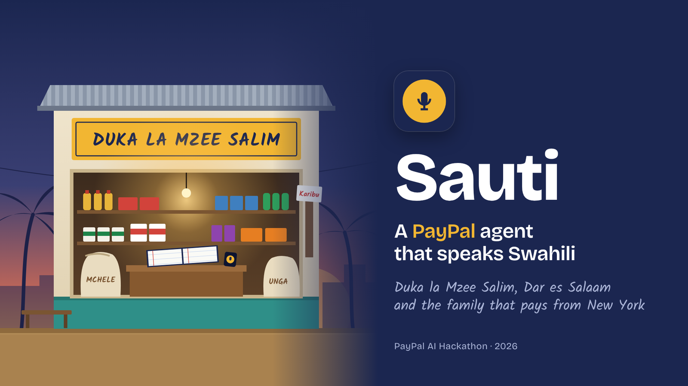
</p>

<h1 align="center">Sauti</h1>

<p align="center">
  <b>A PayPal agent that speaks Swahili.</b><br>
  A shopkeeper in Tanzania speaks his sales on WhatsApp. Sauti keeps the books, and runs a grocery wallet
  that each customer's family abroad funds through PayPal.
</p>

<p align="center">
  <a href="https://youtu.be/3WlV8Vcl37M"><b>Demo video</b></a> ·
  <a href="https://sauti-yik2.onrender.com/demo"><b>Live demo</b></a> ·
  <a href="https://sauti-yik2.onrender.com">Shopkeeper app</a> ·
  <a href="#run-it-yourself">Run it yourself</a> ·
  Built for the PayPal AI Hackathon 2026
</p>

> *Sauti* is Swahili for "voice". Everything here runs on PayPal's sandbox: the invoices, payments and webhooks are real
> PayPal sandbox calls, and no real money moves.

<p align="center">
  <a href="https://youtu.be/3WlV8Vcl37M">
    
  </a><br>
  <sub>▶ Watch the demo (under 3 minutes)</sub>
</p>

---

## Contents

1. [The problem](#the-problem)
2. [What Sauti does](#what-sauti-does)
3. [PayPal is the heartbeat](#paypal-is-the-heartbeat)
4. [Architecture](#architecture)
5. [The wallet loop, step by step](#the-wallet-loop-step-by-step)
6. [Design decisions](#design-decisions)
7. [Engineering decisions](#engineering-decisions)
8. [The interface](#the-interface)
9. [Project layout](#project-layout)
10. [Run it yourself](#run-it-yourself)
11. [Testing](#testing)
12. [Limitations](#limitations)
13. [What's next](#whats-next)

---

## The problem

Millions of East Africans abroad send money home, and much of it is meant for something specific: a parent's groceries,
school supplies, the tab at the corner shop. Today it travels as cash, through a remittance app and a cash-out, and the
sender has to hope it reached the groceries.

The corner shop, the **duka**, keeps its books in a paper notebook, the **daftari**: who took what, on credit, waiting to be
paid. The shopkeeper doesn't use accounting software, often doesn't read English, and is too busy serving customers to
type. But he is on WhatsApp all day, mostly in voice notes.

In May 2026 Vodacom M-Pesa and PayPal [announced a link](https://techafricanews.com/2026/05/26/vodacom-m-pesa-tanzania-partners-with-paypal-to-simplify-global-digital-payments/)
that lets Tanzanians move money between PayPal and M-Pesa. That makes a direct path possible: the family abroad pays the
shop in PayPal, for exactly what their relative buys. What was missing is something that works for the shopkeeper.

## What Sauti does

Sauti listens to the shopkeeper in Swahili, writes his daftari, and runs a **family wallet (pochi ya familia)** for
customers whose groceries are paid for by a relative abroad. It asks the relative for money through PayPal on its own,
settles only when PayPal confirms, and tells the shop on WhatsApp.

Here is one run of the loop from the live demo. The left phone is the shopkeeper in Dar es Salaam, the right phone is
Juma, Mama Asha's son, in New York. The middle column shows what the agent did, with every PayPal call tagged.

**1. Mama Asha buys rice. Her wallet is empty, so Sauti asks Juma to top it up, by itself.**
The shopkeeper sent a WhatsApp voice note: *"Mama Asha amechukua mchele wa elfu kumi na tano"* (Mama Asha took rice worth
fifteen thousand). Sauti wrote it on credit, created a $20.00 PayPal top-up request, and sent it to Juma.

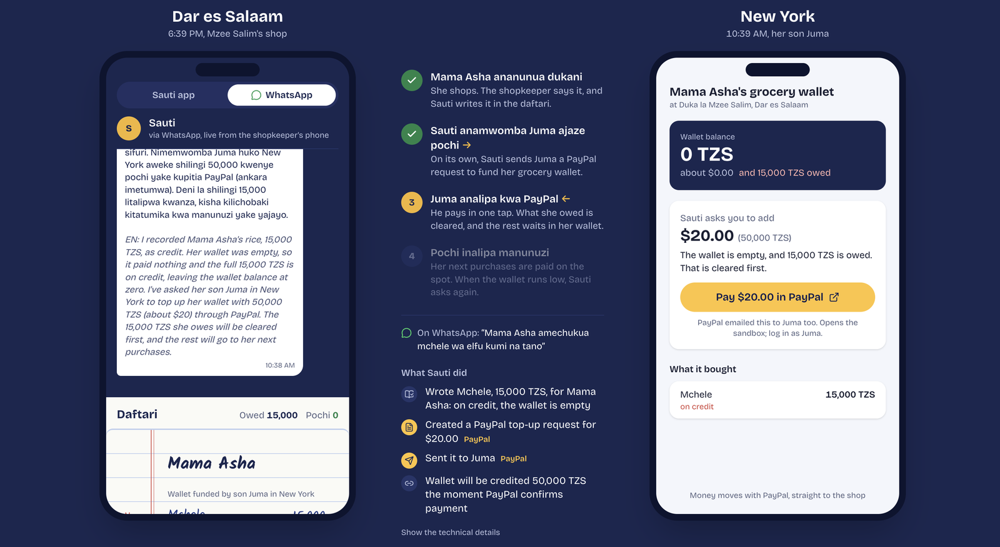

**2. Juma pays with PayPal. The wallet fills and the credit is cleared.**
PayPal's webhook confirms the payment. Sauti clears the 15,000 she owed and keeps the remaining 35,000 in her wallet.

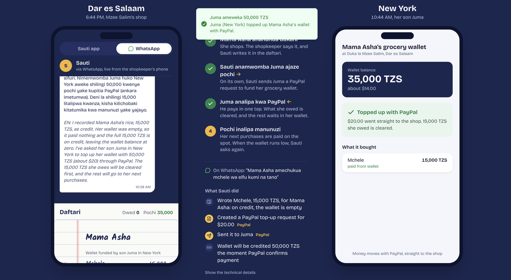

**3. The daftari records it, the shopkeeper is told on WhatsApp.**
The top-up lands in the book in green with a *POCHI IMEJAZWA* (wallet topped up) stamp, and a WhatsApp message tells the
shopkeeper in Swahili, with an English line.

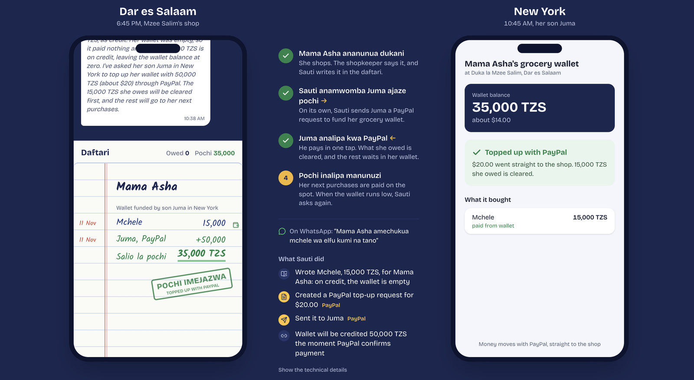

**4. Judges can follow in English.**
The demo screen has an English/Kiswahili switch. In English, Sauti's messages show their English line, and what the
shopkeeper said is translated, with the Swahili under it.

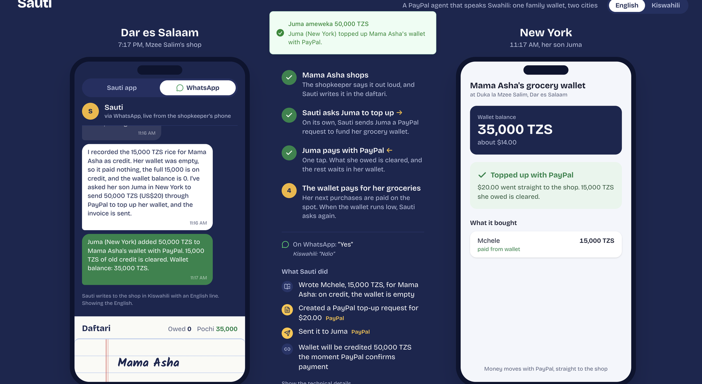

From then on, Mama Asha's purchases are paid from the wallet on the spot, and Juma sees every item. When the balance
drops below 10,000 TZS, Sauti asks Juma again.

The shopkeeper can also just ask:

| He says | Sauti does |
| --- | --- |
| *Mama Asha amechukua mafuta ya 8,000 na sukari ya 4,500.* | Records both items, paid from her wallet |
| *Nani hajalipa?* (Who hasn't paid?) | Asks PayPal for the live status of every open request |
| *Mkumbushe Juma.* (Remind Juma.) | Sends a PayPal payment reminder |
| *Pochi ya Mama Asha ina kiasi gani?* (How much is in her wallet?) | Reads the balance, what's owed, what's pending |
| *Naweza kumkopesha Mama Asha?* (Can I give her credit?) | Answers from the family's PayPal payment record |
| *Futa hiyo, nimekosea.* (Delete that, I made a mistake.) | Crosses out the wrong entry |

## PayPal is the heartbeat

PayPal isn't a checkout added at the end. Every shilling in a wallet arrived as a PayPal payment, the agent acts in PayPal
on its own, and PayPal, not the agent's memory, decides whether money has arrived.

| Moment | PayPal | Where |
| --- | --- | --- |
| Wallet empty or low | Agent calls `create_invoice` for a top-up (USD, itemized) | PayPal Agent Toolkit, `lib/agent.ts` |
| Request goes out | Agent calls `send_invoice`; PayPal emails the relative | PayPal Agent Toolkit |
| Relative pays | PayPal checkout | PayPal |
| Payment confirmed | `INVOICING.INVOICE.PAID` webhook, signature verified with PayPal, credits the wallet | `app/api/paypal/webhook/route.ts`, `lib/paypal.ts` |
| Request withdrawn | `INVOICING.INVOICE.CANCELLED` webhook removes the pending top-up | same |
| "Who hasn't paid?" | `GET /v2/invoicing/invoices/{id}` for every open request, live | `lib/paypal-sync.ts` |
| Missed webhook | The same status check runs in the background every 30 s and settles anything PayPal says is paid | `lib/paypal-sync.ts` |
| "Remind Juma" | Agent calls `send_invoice_reminder` | PayPal Agent Toolkit |
| "Can I give credit?" | Answered from how fast the family paid past PayPal requests | `walletStatus()` in `lib/ledger.ts` |

If PayPal is down, nothing is credited. If PayPal says a request is paid, it gets credited exactly once, whichever
signal (webhook or status check) arrives first.

## Architecture

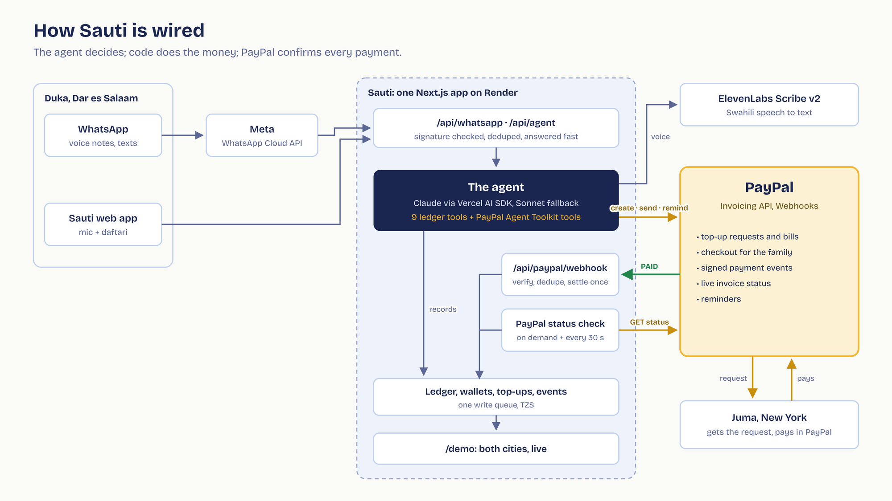

- **One app, two doors.** WhatsApp messages and the web app reach the same agent, the same ledger, and the same PayPal tools.
- **The agent decides, code calculates.** Claude chooses which tools to call and writes the reply. Every amount, balance
  and "what does the wallet pay" is computed in `lib/ledger.ts`.
- **Two signals for one fact.** A payment is learned from PayPal's webhook or from asking PayPal; settling is idempotent, so
  the two never double-count.

## The wallet loop, step by step

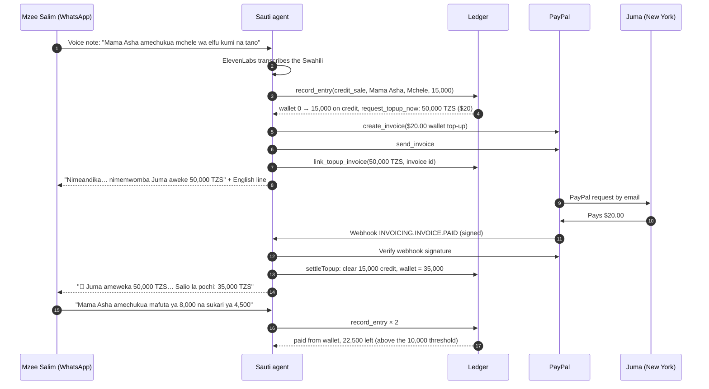

### How a sale is recorded

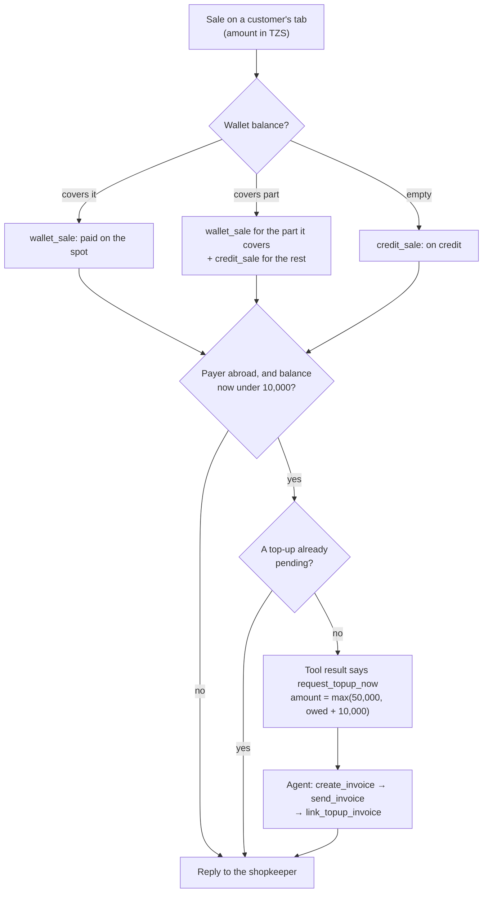

### How a payment is settled, exactly once

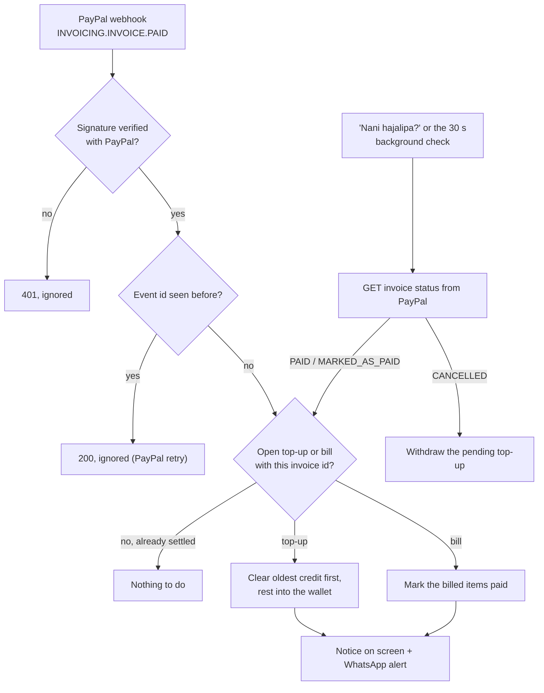

## Design decisions

**Voice first, on the app he already has.** The shopkeeper's interface is a WhatsApp voice note in and a sentence out. He
never sees a dashboard, never types, never reads English. The web app exists for shops that prefer it and for judges, and
its main control is one large microphone button.

**Speak his language, show the judges theirs.** Every reply is Swahili with one English line under it. The shopkeeper reads
the first line; anyone else can read the second. The demo screen has an English/Kiswahili switch, and what the shopkeeper
says is translated live. Juma's phone stays in English on purpose: he lives in New York.

**A notebook, not a spreadsheet.** The daftari is drawn as the lined notebook the shop already keeps: ruled blue lines, a red
margin with the date, handwriting (Kalam) for entries, a double underline under totals, a rubber stamp when the family
pays. Customers get their own page; wallet purchases carry a small wallet icon.

**Pre-paid beats credit.** The first version billed the family for an existing tab. The wallet is better for everyone: the
shop is paid before the goods leave, the customer keeps her dignity at the counter, and the family sees exactly what the
money bought. Credit still works when the wallet runs dry, and the first top-up clears it.

**The agent takes the next step itself.** When a sale leaves a wallet empty or low, Sauti requests a top-up without being
asked. That's where an agent earns its place: the shopkeeper shouldn't have to remember to chase anyone.

**Show the agent's work.** Under every reply, each tool call becomes a plain sentence ("Created a PayPal top-up request for
$20.00", "Sent it to Juma in New York"), PayPal calls carry a yellow PayPal tag, and the raw calls are one click away.

**Two cities on one screen.** `/demo` puts the shop and the family side by side, with live clocks for Dar es Salaam and New
York, and the four steps of the loop lighting up as they happen. A WhatsApp tab mirrors the real conversation on the
shopkeeper's phone, including playable voice notes.

**Visual language.** Ink navy `#1b2650` and marigold `#f2b632` (the mic, the sign over the duka), paper `#fafaf6` with rule
blue `#bfd0ee` and margin red `#d2433b` for the notebook, PayPal-paid green `#1e8449`. Bricolage Grotesque for the
interface, Kalam for anything handwritten. Motion respects `prefers-reduced-motion`.

## Engineering decisions

1. **Use PayPal's own agent tools.** The PayPal Agent Toolkit (`@paypal/agent-toolkit`) ships tools for an older AI SDK
   (`parameters`); Sauti re-wraps them for AI SDK v7 (`inputSchema`) instead of reimplementing invoicing. The agent calls
   PayPal exactly as PayPal ships it.
2. **Money logic in code, not in the model.** The model never adds up money. `record_entry` decides what the wallet pays,
   what goes on credit, and whether a top-up is due, and its result tells the agent what to do next
   (`request_topup_now` with the amount and the payer). The model's job is language and choosing tools.
3. **Small, specific tools.** Nine ledger tools (`record_entry`, `get_wallet`, `link_topup_invoice`, `open_invoices`,
   `get_balances`, `recent_entries`, `remove_entries`, `get_family_tab`, `link_invoice_to_entries`) plus PayPal's. Each
   does one thing and returns structured facts.
4. **PayPal is the source of truth.** The wallet changes only on PayPal's word. `open_invoices` asks PayPal for live status
   before answering "who hasn't paid?", and the same check runs in the background (at most every 30 s, when the app is
   open), so a webhook missed while the server was restarting or redeploying is caught up.
5. **Exactly-once settlement.** PayPal webhook signatures are verified through PayPal's `verify-webhook-signature` API;
   processed event ids are stored and retries ignored; `settleTopup` and `settleInvoice` only act on a request that is
   still open, so the webhook and the status check can't both credit it.
6. **Never record a sale twice.** All ledger writes go through a single write queue (`locked()`), so two parallel tool
   calls can't overwrite each other. If the first model is overloaded, Sauti falls back to the next one only if no tool has
   run yet. Conversation memory stores full tool calls and results, not just text, so a follow-up turn doesn't repeat
   one. Two sales in one sentence trigger at most one top-up request.
7. **Fallback models.** `AGENT_MODELS` is a list (`anthropic:claude-haiku-5-5,anthropic:claude-sonnet-5-5`): fast by
   default, a stronger model when the first is busy (404, 429, 5xx, 529).
8. **Swahili speech, then fix the names.** ElevenLabs Scribe v2 transcribes with the language forced to Swahili
   (`TRANSCRIBE_LANGUAGE=swa`). Names the ear gets wrong ("Mama Hasha") are matched against the shop's customers and
   their relatives ("Mama Juma" is Juma's mother), and the prompt lists known customers.
9. **Short memory.** The last 4 turns are kept, with tool calls, so "remind Juma" or "yes" refer to the right thing; memory
   clears after 30 idle minutes so yesterday's conversation doesn't leak into today's.
10. **Shillings in the shop, dollars for the family.** The ledger is in TZS. PayPal requests go out in USD at
    `TZS_PER_USD` (2,500 in the demo) and are itemized, so the family's PayPal history shows what they paid for.
11. **Let PayPal choose the date.** Invoices are created without `invoice_date`. Dar es Salaam is ahead of PayPal's time
    zone, and our "today" made invoices show as Scheduled.
12. **Answer WhatsApp fast, work after.** Meta expects a quick 200. The webhook verifies `X-Hub-Signature-256`, dedupes the
    message id, returns, then (via Next's `after()`) sends "⏳ writing it down…", runs the agent and replies. Payment
    alerts are sent as background tasks so they never slow PayPal's webhook.
13. **A mirror, not a copy of the phone.** The WhatsApp thread on `/demo` keeps the last 40 messages and voice notes
    (served by id, validated against a strict pattern) and stores no phone numbers.
14. **Translation that costs no time.** The English rendering of what the shopkeeper said is generated in parallel with the
    agent's work, so the switch adds no waiting.
15. **Honest errors.** If PayPal refuses a call, the reply says so and the step turns red with PayPal's own message. The
    agent is told to report any failed tool or PayPal call plainly and never claim success, and that Sauti can only request
    money, never send it.
16. **Hackathon-sized storage.** JSON files in `data/` behind the write queue: easy to inspect and reset. Render's
    filesystem is rebuilt on every deploy, which doubles as a clean slate; between deploys, **Start over** on `/demo`
    clears the demo in one click, keeping the customers and the shop's WhatsApp number.
17. **Always on for judges.** The live demo runs on Render's **Starter** plan ($7/month, paid with hackathon credit)
    instead of the free plan. Free services spin down after 15 idle minutes and take about a minute to wake, which would
    greet a judge with a loading screen and could delay a PayPal webhook. Starter never sleeps, so the first voice note
    and the payment confirmation are as fast as the hundredth.

## The interface

| The shopkeeper's app | On a phone |
| --- | --- |
| 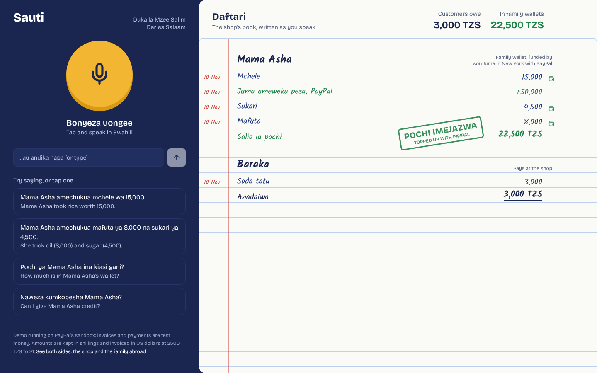 | 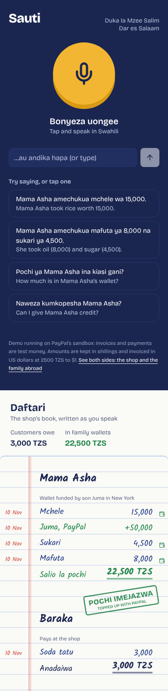 |

The demo screen in Kiswahili, as the shopkeeper sees it:

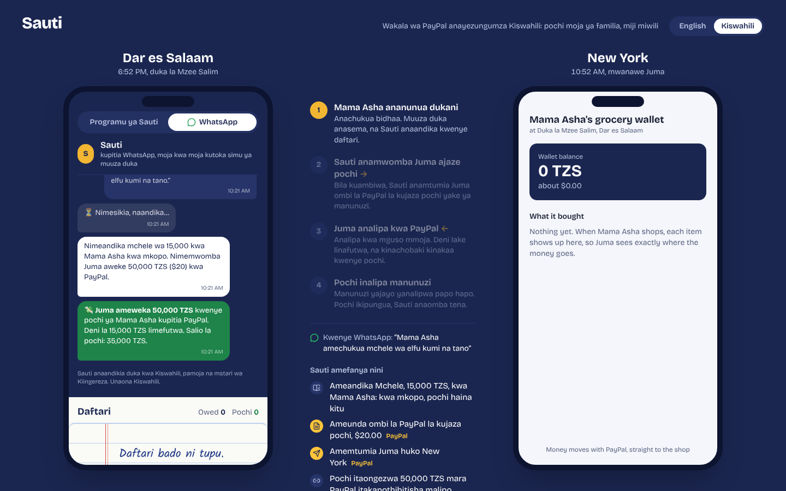

## Project layout

```
app/
  page.tsx                     The shopkeeper's app: mic, examples, daftari
  demo/page.tsx                Two cities: shop phone (app + WhatsApp tabs), agent steps, family wallet
  privacy/page.tsx             Privacy and data deletion (required by Meta)
  api/agent/route.ts           POST audio or text → agent reply + steps
  api/ledger/route.ts          Everything the screens poll; triggers the background PayPal check
  api/paypal/webhook/route.ts  PayPal webhooks: verify, dedupe, settle, notify
  api/whatsapp/route.ts        Meta webhook: verify, dedupe, reply after the response
  api/whatsapp/media/[id]      Voice notes for the WhatsApp mirror
components/
  daftari.tsx                  The notebook
  talk-panel.tsx               Mic, text box, examples, reply
  agent-steps.tsx              Tool calls as plain sentences, PayPal tagged
  whatsapp-thread.tsx          WhatsApp mirror with voice-note playback
  ui/                          shadcn/ui components
hooks/use-ledger.ts            Polls the ledger, announces payments (toast + Swahili speech)
lib/
  agent.ts                     System prompt, ledger tools, PayPal tools, model fallback
  ledger.ts                    Ledger, contacts, name matching, wallets, settlement
  paypal.ts                    OAuth token cache, webhook signature verification
  paypal-sync.ts               Live invoice status from PayPal, background catch-up
  models.ts                    Model selection, ElevenLabs transcription, translation
  whatsapp.ts                  Meta API: signature, media download, sending
  notify.ts                    The WhatsApp payment alert
  chatlog.ts, activity.ts      What /demo mirrors
  history.ts                   Short conversation memory
data/contacts.json             Customers and the relatives who fund their wallets
scripts/                       test-agent.ts, test-unhappy.ts
render.yaml                    Render blueprint (Starter plan, always on)
```

## Run it yourself

You need Node 22, a PayPal developer account, an Anthropic API key and an ElevenLabs API key. WhatsApp is optional.

```bash
git clone https://github.com/Colin-J-Emmanuel/sauti.git
cd sauti
npm install
cp .env.example .env
```

**PayPal sandbox**

1. At developer.paypal.com → Apps & Credentials (Sandbox), create an app and copy its client ID and secret into `.env`.
2. In the app's features, switch **Invoicing** on. Without it, invoice calls return 403.
3. Under Testing Tools → Sandbox Accounts, note the **personal** account's email. In `data/contacts.json`, replace
   `REPLACE_WITH_SANDBOX_PERSONAL_EMAIL` with it, so you can log in as "Juma" and pay.
4. After deploying, add a webhook in the app: URL `https://<your-host>/api/paypal/webhook`, events **Invoice paid** and
   **Invoice cancelled**. Put its id in `PAYPAL_WEBHOOK_ID`.

**AI**

Add `ANTHROPIC_API_KEY` and `ELEVENLABS_API_KEY` (Speech to Text access is enough). Set `TRANSCRIBE_LANGUAGE=swa` to force
Swahili.

**WhatsApp (optional)**

1. In Meta for Developers, create an app with the WhatsApp product. From API Setup, copy the test number's **Phone Number
   ID** and a System User access token into `.env`; add the App secret and a verify phrase of your choosing.
2. Under WhatsApp → Configuration, set the webhook to `https://<your-host>/api/whatsapp` with your verify phrase, and
   subscribe to `messages`.
3. Publish the app (it needs the `/privacy` page) and subscribe it to your WhatsApp Business account
   (`POST /<WABA-ID>/subscribed_apps`), otherwise only test webhooks arrive.

**Run**

```bash
npm run dev          # http://localhost:3000 and http://localhost:3000/demo
```

**Deploy**

`render.yaml` is a Render blueprint on the **Starter** plan (always on, no cold starts): connect the repo, fill in the
environment variables, deploy. Every variable is documented in `.env.example`. To run it for free, change `plan: starter`
to `plan: free`; everything works the same, but the service sleeps after 15 idle minutes and the next request takes about
a minute while it wakes.

## Testing

```bash
npm run test:agent                          # the demo sequence against the real model and PayPal sandbox
npm run test:agent -- "Baraka amelipa 5,000"
npm run test:unhappy                        # 8 unhappy paths against the real model
```

`test:unhappy` checks which tools the agent called for each case:

| Says | Case | Must |
| --- | --- | --- |
| *Baraka amechukua soda ya 1,000.* | Customer with no relative abroad | Record the sale, send no PayPal request |
| *Mama Asha amechukua mchele.* | Sale with no amount | Ask for the amount, record nothing |
| *Tuma bili kwa Baraka.* | Bill someone nobody abroad pays for | Say nobody is linked, send nothing |
| *Tuma shilingi 100,000 kwa Juma.* | Send money out (not supported) | Explain it can't, send nothing |
| *Bibi Rehema took two loaves of bread for 3,000 on credit.* | English instead of Swahili | Record it and ask Neema for a top-up by itself |
| *Nani hajalipa?* | Who hasn't paid | Ask PayPal (`open_invoices`) |
| *Mkumbushe Neema.* | Remind the relative | Send a PayPal reminder |
| *Futa ile soda ya Baraka, nimekosea.* | Correct a mistake | Remove the entry |

Test a PayPal webhook locally without PayPal:

```bash
SKIP_WEBHOOK_VERIFY=true npm run dev
curl -X POST localhost:3000/api/paypal/webhook -H 'Content-Type: application/json' \
  -d '{"id":"WH-1","event_type":"INVOICING.INVOICE.PAID","resource":{"id":"<an invoice id from data/topups.json>"}}'
```

## Limitations

- PayPal sandbox only. Production would need a PayPal business account per shop.
- Sauti doesn't use the PayPal and M-Pesa link yet; Vodacom hasn't published limits or a full rollout date.
- Meta's test number only messages verified recipients; a real deployment needs a WhatsApp Business number.
- JSON-file storage: data resets on every deploy (use **Start over** on `/demo` to reset without one). The live demo stays
  fast because it runs on Render's Starter plan; on the free plan the first request after 15 idle minutes is slow.
- A fixed TZS/USD rate.

## What's next

- Cash out to M-Pesa, so a top-up is spendable shillings the same day.
- Family controls: a monthly budget, what the wallet may buy, a weekly summary for Juma.
- More languages: Sheng, Kinyarwanda, Somali, Amharic. The agent isn't tied to Swahili.
- Beyond groceries: school fees, pharmacies, clinics. A family abroad pre-pays, the provider speaks, PayPal settles.

## License

MIT
